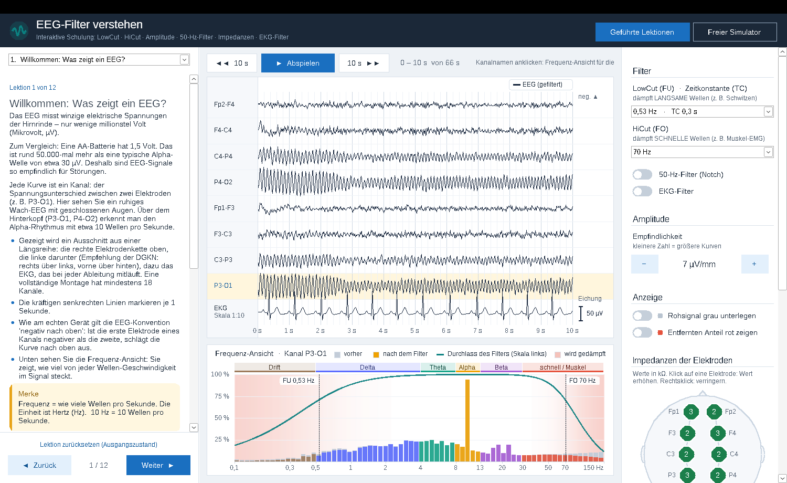

<p align="center"></p>

# NeuroSim

**Der EEG-Simulator: Filter, Impedanzen und Artefakte verstehen.**

NeuroSim ist eine interaktive Schulungsanwendung (VB.NET, WinForms, .NET 8) für MTA in der Neurologie.
Sie zeigt an simulierten EEG-Kurven, wie sich diese Einstellungen auswirken:
- **LowCut (FU, mit Zeitkonstante)**
- **HiCut (FO)**
- **Amplitude (Empfindlichkeit)**
- **50-Hz-Filter**
- **Impedanzen der Elektroden** (Netzbrumm, unruhige Grundlinie, Elektroden-Pops, Gelbrücke)
- **EKG-Filter**

Das didaktische Konzept und die Quellen stehen in [KONZEPT.md](KONZEPT.md).



## Installation

Die fertige `NeuroSim.exe` gibt es unter [Releases](https://github.com/soetbaer/EEGSimulator/releases). Sie läuft ohne Installation und ohne .NET auf Windows 10 und 11 (64 Bit).

Weil die EXE nicht signiert ist, zeigt Windows beim ersten Start eventuell den Hinweis „Der Computer wurde durch Windows geschützt“. Über **Weitere Informationen → Trotzdem ausführen** lässt sie sich starten.

## Bedienung

- **Geführte Lektionen** (12 Kapitel): links lesen, rechts ausprobieren. Mit „Weiter“ geht es zum nächsten Kapitel. „Lektion zurücksetzen“ stellt den Ausgangszustand wieder her.
- **Freier Simulator**: Alle Regler und Signal-Bausteine sind frei wählbar.
- Ein Klick auf einen **Kanalnamen** wählt den Kanal für die Frequenz-Ansicht.
- Die rechte Leiste hat drei Reiter: **Einstellungen** (Filter, Amplitude, Anzeige), **Impedanzen** und **Signal**. Die Lektionen öffnen jeweils den passenden Reiter.
- Im **Kopfschema** (Reiter „Impedanzen“) ändert ein Klick auf eine Elektrode deren Impedanz (Rechtsklick: zurück). Per Tastatur: Pfeiltasten wählen die Elektrode, `+` und `−` ändern den Wert.
- **Abspielen** startet die Schreiblinie: Die Seite bleibt stehen, die Linie läuft von links nach rechts und schreibt die nächste Seite über die alte, wie am EEG-Gerät. Tastatur:
  - `P` startet und stoppt die Wiedergabe.
  - `←` / `→` blättern um 10 s zurück bzw. vor.

## Info, Lizenz und Updates

- Die Schaltfläche **Info** (oder `F1`) zeigt Entwickler, Quellen, Haftungsausschluss und Lizenz.
- **Updates:** NeuroSim fragt beim Start die neueste Versionsnummer bei GitHub ab und bietet eine neue Version zum Installieren an. Die automatische Suche lässt sich im Info-Dialog abschalten; dort gibt es auch „Jetzt nach Updates suchen“. Übertragen werden keine Nutzungsdaten; GitHub sieht technisch bedingt die IP-Adresse.
- Beim Aktualisieren lädt NeuroSim die EXE aus dem Release, prüft sie (Größe, Dateityp, SHA-256-Prüfsumme von GitHub) und ersetzt sich selbst. Liegt die EXE in einem schreibgeschützten Ordner, verweist der Dialog auf die Release-Seite.

## Bauen und Starten

Voraussetzung ist Visual Studio 2022 (Workload „.NET-Desktopentwicklung“) oder das .NET 8 SDK unter Windows.

```
dotnet run
```

Oder in Visual Studio `NeuroSim.vbproj` öffnen und F5 drücken.

Eine einzelne EXE ohne .NET-Installation auf dem Schulungsrechner erzeugen:

```
dotnet publish -c Release -r win-x64 --self-contained -p:PublishSingleFile=true -p:EnableCompressionInSingleFile=true
```

Die EXE liegt danach in `bin\Release\net8.0-windows\win-x64\publish\`.

## Projektstruktur

| Ordner | Inhalt |
|---|---|
| `Dsp/` | Filter (Hochpass/Tiefpass/Notch), FFT, EKG-Template-Subtraktion |
| `Simulation/` | Generator des simulierten EEG mit allen Bausteinen und Artefakten |
| `Training/` | Einstellungen, Lektionstexte (`LessonCatalog.vb`), Live-Erklärungen (`Explainer.vb`) |
| `Services/` | Update-Funktion, Programminformationen, Texte für Quellen und Haftungsausschluss |
| `Assets/` | Logo (`logo.svg`) und Programm-Icon |
| `UI/` | Hauptfenster, EEG-Ansicht, Frequenz-Ansicht, Kopfschema für Impedanzen, Schalter, Info-Karte, Farben (`Theme.vb`) |

## Anpassen

- **Texte der Lektionen**: `Training/LessonCatalog.vb`. Jede Lektion hat Texte und eine Ausgangseinstellung (`Preset`).
- **Auswahllisten** (Zeitkonstanten, HiCut-Werte, µV/mm): `Training/SimSettings.vb` → `FilterText`
- **Laborstandards** (z. B. andere Standardwerte): Preset von Lektion 12 bzw. `SimSettings`-Vorgaben
- **Farben/Schriften**: `UI/Theme.vb`

## Ein Release veröffentlichen

1. In `NeuroSim.vbproj` die `<Version>` erhöhen.
2. EXE erzeugen (Befehl oben) und in `NeuroSim.exe` umbenennen, falls nötig.
3. Auf GitHub ein Release mit dem Tag `vX.Y.Z` anlegen und `NeuroSim.exe` anhängen.

Die Update-Funktion vergleicht die Tag-Nummer mit der Programmversion und lädt die angehängte `.exe`.

## Lizenz

Copyright © 2026 F. Soetbeer

NeuroSim ist freie Software unter der [GNU General Public License, Version 3 oder später](LICENSE). Sie ist kostenlos; jeder darf sie nutzen, weitergeben und verändern. Wer eine veränderte Fassung weitergibt, muss sie unter derselben Lizenz und mit Quellcode weitergeben.

## Haftungsausschluss

NeuroSim dient ausschließlich der Aus-, Fort- und Weiterbildung. Die Kurven sind simuliert. NeuroSim ist kein Medizinprodukt und nicht für Diagnose, Befundung, Therapie oder Überwachung bestimmt. Die Inhalte wurden nach bestem Wissen und Gewissen zusammengestellt, jedoch ohne Gewähr für Richtigkeit, Vollständigkeit und Aktualität. Die Software wird ohne jede Gewährleistung bereitgestellt; die Haftung ist ausgeschlossen, soweit gesetzlich zulässig. Der vollständige Text steht im Info-Dialog der Anwendung.

## Hinweise

- Die Signale sind simuliert und didaktisch vereinfacht. Sie ersetzen keine Geräte-Einweisung.
- Wie groß „1 mm“ am Bildschirm ist, hängt von der Windows-Skalierung ab.
