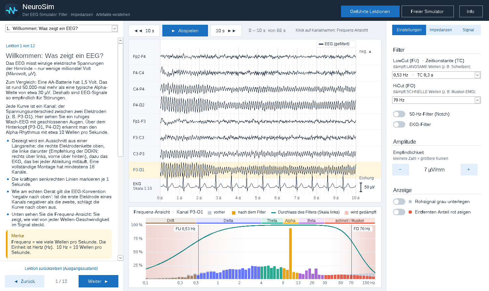

<p align="center"></p>

# NeuroSim

**Der EEG-Simulator: Filter, Impedanzen und Artefakte verstehen.**

NeuroSim ist eine interaktive Schulungsanwendung (VB.NET, WinForms, .NET 8) für Medizinische Technologinnen und Technologen für Funktionsdiagnostik (MTF) und weiteres Fachpersonal in der Neurophysiologie.
Sie zeigt an simulierten EEG-Kurven, wie sich diese Einstellungen auswirken:
- **LowCut (FU, mit Zeitkonstante)**
- **HiCut (FO)**
- **Amplitude (Empfindlichkeit)**
- **50-Hz-Filter**
- **Impedanzen der Elektroden** (Netzbrumm, unruhige Grundlinie, Elektroden-Pops, Gelbrücke)
- **EKG-Filter**

Das didaktische Konzept und die Quellen stehen in [KONZEPT.md](KONZEPT.md).



## Installation

Die fertige `NeuroSim.exe` gibt es unter [Releases](https://github.com/soetbaer/EEGSimulator/releases). Sie läuft ohne Installation und ohne .NET auf Windows 10 und 11 (64 Bit).

Weil die EXE nicht signiert ist, zeigt Windows beim ersten Start eventuell den Hinweis „Der Computer wurde durch Windows geschützt“. Über **Weitere Informationen → Trotzdem ausführen** lässt sie sich starten.

## Bedienung

- **Geführte Lektionen** (12 Kapitel): links lesen, rechts ausprobieren. Mit „Weiter“ geht es zum nächsten Kapitel. „Lektion zurücksetzen“ stellt den Ausgangszustand wieder her.
- **Freier Simulator**: Alle Regler und Signal-Bausteine sind frei wählbar.
- Ein Klick auf einen **Kanalnamen** wählt den Kanal für die Frequenz-Ansicht.
- Die rechte Leiste hat drei Reiter: **Einstellungen** (Filter, Amplitude, Anzeige), **Impedanzen** und **Signal**. Die Lektionen öffnen jeweils den passenden Reiter.
- Im **Kopfschema** (Reiter „Impedanzen“) ändert ein Klick auf eine Elektrode deren Impedanz (Rechtsklick: zurück). Per Tastatur: Pfeiltasten wählen die Elektrode, `+` und `−` ändern den Wert.
- **Abspielen** startet die Schreiblinie: Die Seite bleibt stehen, die Linie läuft von links nach rechts und schreibt die nächste Seite über die alte, wie am EEG-Gerät. Tastatur:
  - `P` startet und stoppt die Wiedergabe.
  - `+` / `−` machen die Kurven größer bzw. kleiner (Amplitude).
  - `←` / `→` blättern um 10 s zurück bzw. vor. Die Seiten liegen auf vollen 10 s; die letzte Seite (60–66 s) ist nur teilweise gefüllt.

## Info, Lizenz und Updates

- Die Schaltfläche **Info** (oder `F1`) zeigt Entwickler, Quellen, Haftungsausschluss und Lizenz.
- **Updates:** Beim ersten Start fragt NeuroSim einmal, ob es beim Start nach neuen Versionen suchen darf. Ohne Zustimmung wird nichts abgefragt. Mit Zustimmung fragt NeuroSim höchstens einmal am Tag die neueste Versionsnummer bei GitHub ab und bietet eine neue Version zum Installieren an. Die Auswahl lässt sich im Info-Dialog ändern; dort gibt es auch „Jetzt nach Updates suchen“. Übertragen werden keine Nutzungsdaten; GitHub sieht technisch bedingt die IP-Adresse.
- Beim Aktualisieren lädt NeuroSim die `NeuroSim.exe` aus dem Release, prüft sie (Größe, Dateityp und, falls dem Release eine `NeuroSim.exe.sha256` beiliegt, die SHA-256-Prüfsumme) und ersetzt sich selbst. Liegt die EXE in einem schreibgeschützten Ordner, verweist der Dialog auf die Release-Seite.
- **Für Administratoren:** Die Update-Funktion (Suche und Selbst-Update) lässt sich ganz abschalten, entweder durch eine leere Datei `NeuroSim.noupdate` im Ordner der EXE oder durch den Registry-Wert `DisableUpdate` = `1` unter `HKEY_LOCAL_MACHINE\Software\Policies\NeuroSim`. Der Info-Dialog zeigt dann „vom Administrator abgeschaltet“.

## Bauen und Starten

Voraussetzung ist Visual Studio 2022 (Workload „.NET-Desktopentwicklung“) oder das .NET 8 SDK unter Windows.

```
dotnet run
```

Oder in Visual Studio `NeuroSim.vbproj` öffnen und F5 drücken.

Eine einzelne EXE ohne .NET-Installation auf dem Schulungsrechner erzeugen:

```
dotnet publish NeuroSim.vbproj -c Release -r win-x64 --self-contained -p:PublishSingleFile=true -p:EnableCompressionInSingleFile=true -p:IncludeNativeLibrariesForSelfExtract=true -p:DebugType=none
```

Die EXE liegt danach in `bin\Release\net8.0-windows\win-x64\publish\`.

## Tests und CI

Im Ordner `Tests/` liegt ein Testprojekt (xUnit). Es prüft die Zahlen, auf die sich die Lektionstexte stützen (Filter, Simulation, Voreinstellungen der Lektionen), und die Update-Funktion:

```
dotnet test Tests/NeuroSim.Tests.vbproj
```

Bei jedem Push baut GitHub Actions (`.github/workflows/ci.yml`) die Anwendung unter Windows, führt die Tests aus und stellt die fertige `NeuroSim.exe` 14 Tage lang als Artefakt `NeuroSim-exe` bereit.

## Projektstruktur

| Ordner | Inhalt |
|---|---|
| `Dsp/` | Filter (Hochpass/Tiefpass/Notch), FFT, EKG-Template-Subtraktion |
| `Simulation/` | Generator des simulierten EEG mit allen Bausteinen und Artefakten |
| `Training/` | Einstellungen, Lektionstexte (`LessonCatalog.vb`), Live-Erklärungen (`Explainer.vb`) |
| `Services/` | Update-Funktion, Programminformationen, Texte für Quellen und Haftungsausschluss |
| `Assets/` | Logo (`logo.svg`) und Programm-Icon |
| `Tests/` | Automatische Tests (xUnit) |
| `UI/` | Hauptfenster, EEG-Ansicht, Frequenz-Ansicht, Kopfschema für Impedanzen, Schalter, Info-Karte, Farben (`Theme.vb`) |

## Anpassen

- **Texte der Lektionen**: `Training/LessonCatalog.vb`. Jede Lektion hat Texte und eine Ausgangseinstellung (`Preset`).
- **Auswahllisten** (Zeitkonstanten, HiCut-Werte, µV/mm): `Training/SimSettings.vb` → `FilterText`
- **Laborstandards** (z. B. andere Standardwerte): Preset von Lektion 12 bzw. `SimSettings`-Vorgaben
- **Farben/Schriften**: `UI/Theme.vb`

## Ein Release veröffentlichen

1. In `NeuroSim.vbproj` die `<Version>` erhöhen.
2. In `RELEASE_NOTES.md` beschreiben, was sich geändert hat. Die Datei wird zum Text des Releases.
3. Beides auf `main` bringen.
4. Auf GitHub unter **Actions → Release veröffentlichen → Run workflow** (Branch `main`) starten. Der Lauf baut und testet die Anwendung und legt das Release mit dem Tag `X.Y.Z` sowie `NeuroSim.exe` und `NeuroSim.exe.sha256` an. Gibt es die Version schon, bricht er ab, außer `replace` ist angehakt.

Die Update-Funktion liest die Tag-Nummer des neuesten Releases, vergleicht sie mit der Programmversion und lädt `NeuroSim.exe` aus diesem Release. Die Datei `NeuroSim.exe.sha256` ist freiwillig; liegt sie bei, wird die Prüfsumme der heruntergeladenen EXE damit verglichen.

## Code-Signatur

Wie die Windows-Programmdatei signiert wird und wer dafür verantwortlich ist, steht in der [Code signing policy](CODE_SIGNING_POLICY.md). Dort steht auch die Datenschutzerklärung zur Update-Funktion.

## Lizenz

Copyright © 2026 F. Soetbeer

NeuroSim ist freie Software unter der [GNU General Public License, Version 3 oder später](LICENSE). Sie ist kostenlos; jeder darf sie nutzen, weitergeben und verändern. Wer eine veränderte Fassung weitergibt, muss sie unter derselben Lizenz und mit Quellcode weitergeben.

## Haftungsausschluss

NeuroSim dient ausschließlich der Aus-, Fort- und Weiterbildung. Die Kurven sind simuliert. NeuroSim ist kein Medizinprodukt und nicht für Diagnose, Befundung, Therapie oder Überwachung bestimmt. Die Inhalte wurden nach bestem Wissen und Gewissen zusammengestellt, jedoch ohne Gewähr für Richtigkeit, Vollständigkeit und Aktualität. Die Software wird ohne jede Gewährleistung bereitgestellt; die Haftung ist ausgeschlossen, soweit gesetzlich zulässig. Der vollständige Text steht im Info-Dialog der Anwendung.

## Hinweise

- Die Signale sind simuliert und didaktisch vereinfacht. Sie ersetzen keine Geräte-Einweisung.
- Wie groß „1 mm“ am Bildschirm ist, hängt von der Windows-Skalierung ab.
